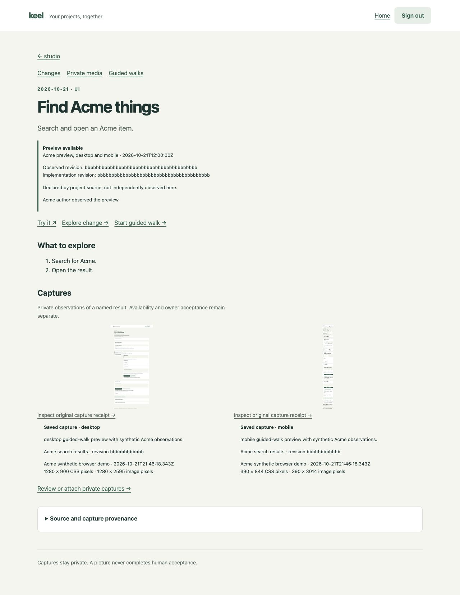
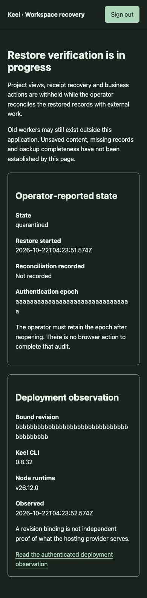

# Explore the Plates web workspace

Start with Home: each project should tell you what needs your decision, what is
ready to test and what changed recently. Open a project to keep that lens while
investigating its work; return to the fleet for comparisons and shared learning.
[Using Home](web-home.md) explains freshness and coverage. The
[setup guide](web-workspace-setup.md) explains private login and data ownership.

These are actual browser captures of the application with **synthetic Acme data**,
taken on 21 October 2026. They are dated implementation evidence, not screenshots
of your private projects or proof of production activation. Navigation is being
unified in phase107; each evidence record names the revision and limits of its
capture. A phone-sized browser capture does not replace a physical-device walk.

## Test and explore a change

A change explains the outcome, links to a preview and offers a guided walk. Its
capture slots retain revision, environment and viewport, so a picture is useful
context rather than an unexplained attachment.

In a guided walk, each step has an expected result and **This works**, **Doesn't
work** or **Can't test yet**. A failure retains your details; saving private
progress does not accept the phase. Open the
[mobile walk capture](../evidence/images/2026-10-21-guided-walk-mobile.jpg) to inspect
that flow, then read [Guided walks](web-walks.md) for source and acceptance rules.

## Browse the other journeys

| Journey | Captures | Guide and recorded proof |
| --- | --- | --- |
| Guided testing | [Desktop](../evidence/images/2026-10-21-guided-walk-desktop.jpg) · [Mobile](../evidence/images/2026-10-21-guided-walk-mobile.jpg) | [Guide](web-walks.md) · [Evidence](../evidence/2026-10-21-web-guided-walks.md) |
| Recent additions and captures | [Desktop](../evidence/images/2026-10-21-journal-desktop.png) · [Mobile](../evidence/images/2026-10-21-journal-mobile.png) | [Guide](web-changes.md) · [Evidence](../evidence/2026-10-21-web-visual-journal.md) |
| Daily plan and shared lessons | [Daily desktop](../evidence/images/2026-10-21-daily-desktop.png) · [Daily mobile](../evidence/images/2026-10-21-daily-mobile.png) · [Learning](../evidence/images/2026-10-21-learning-mobile.png) | [Guide](web-daily-learning.md) · [Evidence](../evidence/2026-10-21-web-daily-learning.md) |
| Routine definitions and attempts | [Routine list](../evidence/images/2026-10-21-routines-mobile.png) · [Attempt desktop](../evidence/images/2026-10-21-routine-attempt-desktop.png) · [Attempt mobile](../evidence/images/2026-10-21-routine-attempt-mobile.png) | [Guide](web-routine-history.md) · [Evidence](../evidence/2026-10-21-web-routine-history.md) |
| Bounded worker operations | [Review](../evidence/images/2026-10-21-jobs-preview-desktop.png) · [Running](../evidence/images/2026-10-21-jobs-running-mobile.png) · [Recovery](../evidence/images/2026-10-21-jobs-recovery-mobile.png) | [Guide](web-workers.md) · [Evidence](../evidence/2026-10-21-web-workers.md) |
| Fleet versions and updates | [Versions](../evidence/images/2026-10-21-fleet-versions-desktop.jpg) · [Exact publication](../evidence/images/2026-10-21-fleet-publication-mobile.jpg) · [Recovery](../evidence/images/2026-10-21-fleet-recovery-mobile.jpg) | [Guide](web-fleet-updates.md) · [Evidence](../evidence/2026-10-21-web-fleet-updates.md) |
| Lesson adoption | [Desktop trace](../evidence/images/2026-10-21-fleet-lesson-trace-desktop.jpg) · [Mobile trace](../evidence/images/2026-10-21-fleet-lesson-trace-mobile.jpg) | [Guide](web-fleet-updates.md) · [Evidence](../evidence/2026-10-21-web-fleet-updates.md) |
| Connections and capacity | [Desktop](../evidence/images/2026-10-21-connections-desktop.png) · [Mobile](../evidence/images/2026-10-21-connections-mobile.png) · [Recovery](../evidence/images/2026-10-21-connections-recovery-mobile.png) | [Guide](web-connections.md) · [Evidence](../evidence/2026-10-21-web-connections.md) |
| Model planning and policy | [Source review](../evidence/images/2026-10-21-model-review-desktop.jpg) · [Mobile quote](../evidence/images/2026-10-21-model-quote-mobile.jpg) · [Saved summary](../evidence/images/2026-10-21-model-summary-mobile.jpg) · [Policy](../evidence/images/2026-10-21-model-policy-desktop.jpg) | [Guide](web-model-routing.md) · [Evidence](../evidence/2026-10-21-web-model-routing.md) |

## Open your own workspace

Use your approved HTTPS deployment and sign in with the GitHub account authorized
by its private membership record. Home is `/`; project views use
`/projects/<project-id>`. The source-defined **Try it** links belong to individual
changes and point at their actual preview or serving surface. Plates does not invent
a preview URL when none has been provided.

Publishing source, running a workflow, sending text to a model and uploading a
capture each have their own activation and review. The README and phase records
distinguish implemented flows from the features enabled on the deployed service.
For cross-device drafts and session recovery, see
[Move between projects and resume your work](web-operation-experience.md).

## Shared navigation and night controls

The 22 October 2026 screenshots below show the actual authenticated application
with synthetic Acme source data. They establish rendering only: browser input was
unavailable on the locked host, so approval, keyboard and recovery interactions
remain unverified in this capture session.

- [Mobile night retry review](../evidence/2026-10-22-web-operations/night-retry-mobile.png)
  shows the original attempt, actor, allowance and declared effects.
- [Desktop night retry review](../evidence/2026-10-22-web-operations/night-retry-desktop.png)
- [Desktop Daily planning](../evidence/2026-10-22-web-operations/daily-desktop.png)
- [Narrow mobile Daily planning](../evidence/2026-10-22-web-operations/daily-mobile.png)

## Restore status — 22 October 2026

These are actual browser renders of the synthetic Acme recovery service. The
preview injects a synthetic test session; it does not prove a real browser login,
physical device input, a live backup or the owner's reconciliation. Both widths
had no horizontal overflow. The [recovery guide](web-recovery.md) describes the
operator procedure and private trial worksheet.

[Desktop recovery](../evidence/2026-10-22-web-restore/recovery-desktop.png) ·
[Mobile recovery](../evidence/2026-10-22-web-restore/recovery-mobile.png)

